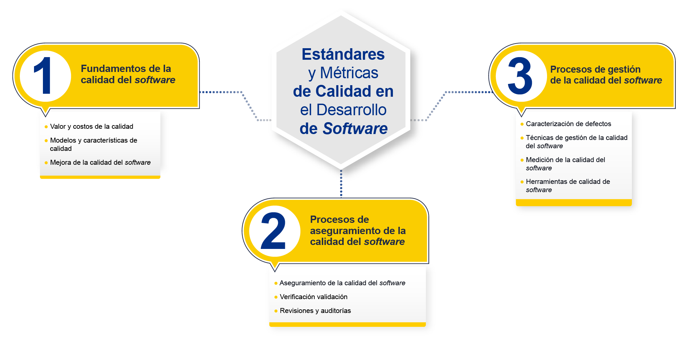

# Curso: Estándares y Métricas de Calidad en el Desarrollo de Software

**Institución:** Universidad Minuto de Dios (UNIMINUTO)  
**Curso:** Estándares y Métricas de Calidad en el Desarrollo de Software  
**Programa académico:** Especialización en Desarrollo de Software 
**Nivel académico:** Especialización
**Modalidad:** Virtual  
**Herramientas:**  
**Docente:** Ing. de sistemas César Alfonso Bolado Silva

## 🎓 Temática del curso

- ✅ **Semana 1:** Fundamentos de la calidad de software.
- ✅ **Semana 2:** Aseguramiento de la calidad del software: validación, verificación, revisiones y auditorías.
- ✅ **Semana 3:** Aseguramiento de la calidad del software: Caracterización de defectos.
- ✅ **Semana 4:** Especificación de requisitos del software.
- ✅ **Semana 5:** Técnicas de gestión de la calidad.
- ✅ **Semana 6:** Herramientas y requisitos de calidad de software.
- ✅ **Semana 7:** Técnicas de gestión y medición en la calidad de software.
- ✅ **Semana 8:** Herramientas de calidad de software.

## 🎯 Resultados de aprendizaje del curso

- Evalúa el aseguramiento de la calidad en la construcción de software de calidad implementando la verificación validación, Revisiones y auditorías.
- Especifica la utilización de Técnicas de gestión de la calidad del software, estándares y metodologías el diseño en la Medición de la calidad del software.
- Implementa técnicas de gestión de la calidad del software en los procesos de Medición de la calidad del software.

## 👨‍💻 Aprendizajes específicos

- Conoce la cultura y ética de la ingeniería de software.
- Comprende conceptos básicos sobre estándares y métricas.
- Asegura la calidad a través de la definición de los modelos y características de calidad.
- Conoce los principios fundamentales de calidad implementando la verificación validación, revisiones y auditorías.
- Estructura el Informe sobre los estándares y metodologías el diseño en la Medición de la calidad del software.
- Identifica el aseguramiento de la calidad del software.
- Identifica la caracterización de los defectos de software.
- Realiza verificación validación de software.
- Revisa y audita la construcción de software.
- Realiza la especificación del software.
- Identifica los requisitos de calidad del software.
- Establece las herramientas de calidad de software.
- Clasifica las técnicas de gestión de la calidad del software.
- Implementa el aseguramiento de la calidad en la construcción de software.
- Aplica las técnicas de gestión de la calidad del software.

## 📋 Plan de trabajo

| Semana | Contenido | Resultados de aprendizaje                                                                                                                                                                                                                                                                                                                                                             | Carpeta   | Actividad                                                      |
| :---- | :---- |:--------------------------------------------------------------------------------------------------------------------------------------------------------------------------------------------------------------------------------------------------------------------------------------------------------------------------------------------------------------------------------------|:----------|:---------------------------------------------------------------|
| 1 | Fundamentos de la calidad de software. | Conoce la cultura y ética de la ingeniería de software. Comprende conceptos básicos sobre estándares y métricas. Asegura la calidad a través de la definición de los modelos y características de calidad.                                                                                                                                                                            | Semana_1 | [Aplicación interactiva](https://cesarabs54.github.io/Aplicacion-interactiva-EMCDS/) (recurso de apoyo para todas las semanas, no es una actividad exclusiva de la Semana 1) |
| 2 | Aseguramiento de la calidad del software: validación, verificación, revisiones y auditorías. | Conoce los principios fundamentales de calidad implementando la verificación validación, revisiones y auditorías. Comprende conceptos básicos sobre estándares y métricas. Estructura el informe sobre los estándares y metodologías el diseño en la medición de la calidad del software. Realiza verificación y validación de software. Revisa y audita la construcción de software. | Semana_2 | [EDSTV011_A2_V2.pdf](Semana_2/Semana_2_Actividad/EDSTV011_A2_V2.pdf) [Semana_2_Caso_MediCitas.md](Semana_2/Semana_2_Actividad/Semana_2_Caso_MediCitas.md) |
| 3 | Aseguramiento de la calidad del software: Caracterización de defectos. | Identifica el aseguramiento de la calidad del software. Identifica la caracterización de los defectos de software.                                                                                                                                                                                                                                                                    | Semana_3 | [EDSTV011_F3_V2.pdf](Semana_3/Semana_3_Foro/EDSTV011_F3_V2.pdf) [Semana_3_Foro_de_discución.md](Semana_3/Semana_3_Foro/Semana_3_Foro_de_discución.md) |
| 4 | Especificación de requisitos del software. | Realiza la especificación del software.                                                                                                                                                                                                                                                                                                                                               | Semana_4  | [EDSTV011_A4_V2.pdf](Semana_4/Semana_4_Actividad/EDSTV011_A4_V2.pdf) |
| 5 | Técnicas de gestión de la calidad. | Realiza la especificación del software. Identifica los requisitos de calidad del software.                                                                                                                                                                                                                                                                                            | Semana_5  |                                                                |
| 6 | Herramientas y requisitos de calidad de software. | Identifica los requisitos de calidad del software. Establece las herramientas de calidad de software.                                                                                                                                                                                                                                                                                 | Semana_6  |                                                                |
| 7 | Técnicas de gestión y medición en la calidad de software. | Establece las herramientas de calidad de software. Clasifica las técnicas de gestión de la calidad del software.                                                                                                                                                                                                                                                                      | Semana_7  |                                                                |
| 8 | Herramientas de calidad de software. | Implementa el aseguramiento de la calidad en la construcción de software. Aplica las técnicas de gestión de la calidad del software.                                                                                                                                                                                                                                                                                                                                                     | Semana_8  |                                                                |

## 🌐 Recurso interactivo

Aplicación web con simuladores, calculadoras, clasificadores y quizzes para practicar los temas del curso: [Abrir la aplicación interactiva](https://cesarabs54.github.io/Aplicacion-interactiva-EMCDS/). Es un recurso de apoyo para todas las semanas; aparece enlazada en la Semana 1 solo por ser el primer punto de acceso, pero no pertenece a una semana en particular. Es una práctica sin calificación y no reemplaza el material oficial ni las actividades evaluables.

https://cesarabs54.github.io/Aplicacion-interactiva-EMCDS/

## 📚 Bibliografía — Algunos recursos en español

Recursos en español como sustitutos reales de la bibliografía original (mayormente en inglés) del curso, organizados según el tema que cubren.

---

### Semana 4 — Especificación de requisitos del software

- Peláez Valencia, L., Toro Lazo, A., Arias Vargas, J., & Rodríguez Franco, D. (2019). [Ingeniería de Software: el aseguramiento de la calidad de los requisitos en la industria del software en el eje cafetero colombiano](https://revistascientificas.cuc.edu.co/ingecuc/article/download/2058/2481). *INGE CUC*, 15(2), 110-122.
- Arias, M. (2007). [La ingeniería de requerimientos y su importancia en el desarrollo de proyectos de software](https://www.redalyc.org/articulo.oa?id=66612870011). *InterSedes: Revista de las Sedes Regionales* (Universidad de Costa Rica).
- Molina Hernández, Y., Granda Dihigo, A., & Velázquez Cintra, A. (2019). [Los requisitos no funcionales de software. Una estrategia para su desarrollo en el Centro de Informática Médica](http://scielo.sld.cu/scielo.php?script=sci_arttext&pid=S2227-18992019000200077&lng=es&nrm=iso&tlng=es). *Revista Cubana de Ciencias Informáticas*, 13(2), 77-90.

**Recursos complementarios:**

- [Ingeniería de Software: el aseguramiento de la calidad de los requisitos en la industria del software en el eje cafetero colombiano (INGE CUC)](https://revistascientificas.cuc.edu.co/ingecuc/article/download/2058/2481)
- [La ingeniería de requerimientos y su importancia en el desarrollo de proyectos de software (Redalyc)](https://www.redalyc.org/articulo.oa?id=66612870011)
- [Los requisitos no funcionales de software. Una estrategia para su desarrollo en el Centro de Informática Médica (SciELO Cuba)](http://scielo.sld.cu/scielo.php?script=sci_arttext&pid=S2227-18992019000200077&lng=es&nrm=iso&tlng=es)
- [Especificación de Requisitos según el estándar de IEEE 830 (UCM)](https://www.fdi.ucm.es/profesor/gmendez/docs/is0809/ieee830.pdf)

---

## 📚 Webgrafía — Algunos recursos de apoyo en español

---

---
