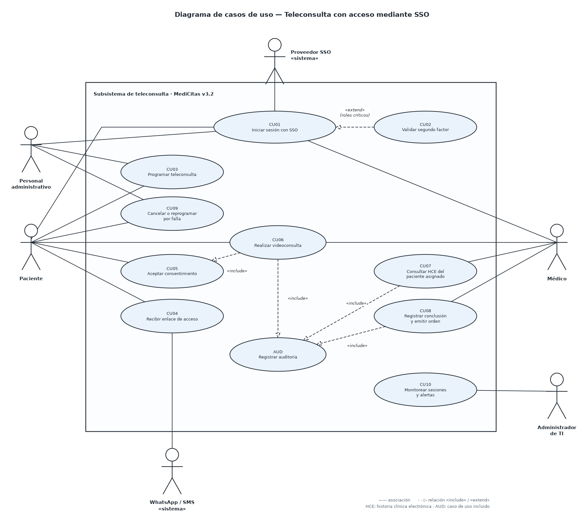
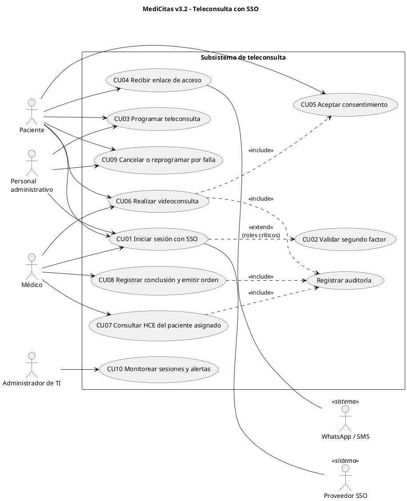
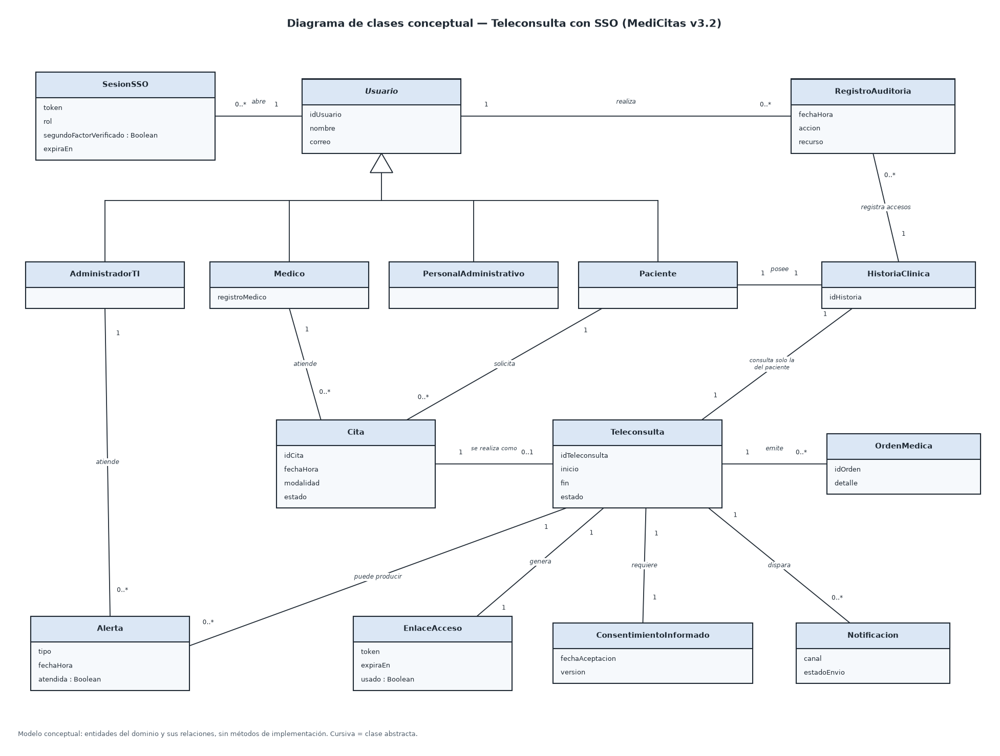
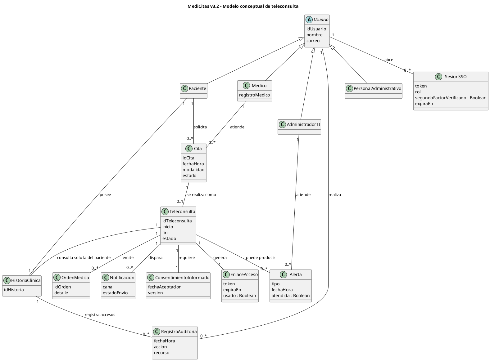

# Semana 4 — Esqueleto de la actividad EDSTV011_A4 con MediCitas

> **Cómo usar este archivo.** Es un esqueleto de trabajo, no el entregable. Cada sección trae la estructura, ejemplos y marcas `[COMPLETAR]` donde va tu propio análisis. Los identificadores (RFT, RNFT, CU, CP, PC) son propios de esta actividad; no reutilices los de la Semana 2 ni las respuestas de las presentaciones, porque la rúbrica castiga el plagio con 0.0.
>
> **Escenario.** Puedes usar este escenario (MediCitas) o el que tú selecciones. Los pasos y la estructura de este archivo sirven igual para cualquier escenario.

## Decisión de alcance

| Elemento | Decisión |
|:--|:--|
| Escenario | MediCitas v3.2 (IPS Salud Especial), según el caso de la Semana 2 |
| Subsistema modelado | **Teleconsulta con acceso mediante SSO** |
| Por qué este recorte | Evita repetir agendamiento y cancelación (ya trabajados en clase) y concentra los incidentes más graves del caso: INC-101, INC-102, INC-103 y INC-105 |
| Fuera de alcance | Facturación DIAN, recetas electrónicas completas, reportes gerenciales, integración AS/400 y pasarela de pagos |

---

# 1. Portada

| Campo | Contenido |
|:--|:--|
| Título | Modelado UML y especificación con aseguramiento de la calidad: teleconsulta con SSO en MediCitas v3.2 `[ajústalo]` |
| Estudiante | `[Nombre completo]` |
| Curso | Estándares y Métricas de Calidad en el Desarrollo de Software (Q6-NRC-1384) |
| Semana / actividad | Semana 4 — EDSTV011_A4 |
| Profesor | César Alfonso Bolado Silva |
| Fecha de entrega | `[dd/mm/aaaa]` |

Nombre del archivo: `primerapellido_primernombre_modeladodigital` (la V2 pide `primerapellido_primernombre_nombredelaactividad`).

---

# 2. Introducción

Escribe 1 o 2 párrafos que respondan:

1. **Qué modelas:** el subsistema de teleconsulta de MediCitas v3.2 y su acceso por SSO.
2. **Para qué:** especificarlo de forma que cada requisito sea verificable y quede enlazado con pruebas y puntos de control.
3. **Por qué importa:** en la Semana 2 se detectaron fallos de seguridad (acceso a HCE ajenas, video sin cifrar, auditoría incompleta) que nacen de requisitos poco verificables o sin pruebas. Aquí se previenen desde la especificación.
4. **Qué contiene el documento:** una línea por sección.

---

# 3. Desarrollo

## 3.1 Descripción del sistema propuesto

Resume en 5 a 8 líneas, con tus palabras:

- IPS Salud Especial: 12 clínicas ambulatorias; equipo Scrum de 8 personas; alcance de la v3.2 congelado y entrega en 3 semanas.
- Qué hace la teleconsulta: un paciente, ya autenticado con SSO, se une a una videoconsulta con su médico y este consulta la historia clínica (HCE) únicamente de ese paciente.
- Restricciones que condicionan el diseño: Ley 1581 de 2012, Resolución 1995 de 1999, Resolución 2654 de 2019 (telesalud) y disponibilidad ≥ 99,5 % de 7 a. m. a 9 p. m.

### Actores

| Actor | Tipo | Rol en el subsistema |
|:--|:--|:--|
| Paciente | Primario | Se autentica, acepta el consentimiento y asiste a la teleconsulta |
| Médico | Primario | Atiende la teleconsulta, consulta la HCE del paciente asignado y registra el resultado |
| Personal administrativo | Primario | Programa o reprograma teleconsultas |
| Administrador de TI | Secundario | Monitorea sesiones y atiende alertas |
| Proveedor de identidad (SSO) | Sistema externo | Valida credenciales y segundo factor |
| WhatsApp Business / SMS | Sistema externo | Envía enlace y recordatorio |
| Servidor de videoconferencia (AWS) | Sistema externo | Transporta el video cifrado |

## 3.2 Especificación estructurada desde el aseguramiento de la calidad

### 3.2.1 Contexto y stakeholders (siguiendo el modelo procedimental)

Aplica los dos primeros pasos de Cornejo-Aparicio et al. (2020) de forma resumida:

| Artefacto | Qué poner |
|:--|:--|
| Tabla de escenarios | 2 o 3 escenarios reales: paciente en zona rural con red débil, médico que atiende desde otra sede, reprogramación por caída del video `[COMPLETAR]` |
| Tabla de usuarios | Una fila por actor con nivel técnico, frecuencia de uso y expectativa de calidad `[COMPLETAR]` |
| Objetivo del sistema | Una frase medible, por ejemplo: "Atender teleconsultas con identidad verificada, video cifrado y trazabilidad completa del acceso a la HCE" |

### 3.2.2 Criterios de calidad de cada requisito

Cada requisito se revisa con las propiedades de IEEE 830 / ISO/IEC/IEEE 29148. Úsalas como lista de chequeo y deja el resultado en una columna de la tabla de requisitos.

| Propiedad | Pregunta de control |
|:--|:--|
| Verificable | ¿Existe una prueba que dé un resultado objetivo de cumple o no cumple? |
| No ambiguo | ¿Admite una sola interpretación? ¿Evita palabras como "rápido" o "seguro" sin cifra? |
| Completo | ¿Indica actor, condición, acción y resultado esperado? |
| Consistente | ¿No contradice a otro requisito? |
| Trazable | ¿Tiene identificador y enlace a un caso de uso y a un caso de prueba? |

### 3.2.3 Ficha de especificación (plantilla, una por requisito clave)

| Campo | Ejemplo para RFT-06 |
|:--|:--|
| ID | RFT-06 |
| Nombre | Videoconsulta con cifrado extremo a extremo |
| Descripción | Mientras dure la teleconsulta, el audio y el video entre paciente y médico viajan cifrados de extremo a extremo |
| Actores | Paciente, Médico |
| Prioridad | Alta (MoSCoW: Must) |
| Fuente | Resolución 2654/2019; lección del incidente INC-103 de la Semana 2 |
| Precondiciones | Ambos participantes autenticados; consentimiento aceptado |
| Postcondiciones | Sesión cerrada y clave de sesión descartada |
| Criterio de aceptación | Ver AC-06 |
| Caso de uso / Prueba | CU06 / CP-06, CP-07 |
| Calidad (IEEE 830) | Verificable, no ambiguo, completo, consistente: `[marca ✓]` |

## 3.3 Requisitos funcionales

Prioridad según MoSCoW. Ajusta, añade o elimina; la rúbrica pide requisitos **completos y medibles**, y una cifra concreta ayuda.

| ID | Requisito (formato: "El sistema debe…") | Prioridad | Origen |
|:--|:--|:-:|:--|
| RFT-01 | El sistema debe permitir iniciar sesión una sola vez (SSO) a pacientes, médicos y personal administrativo y acceder al módulo de teleconsulta sin volver a autenticarse. | Must | Cambio de SSO de la v3.2 |
| RFT-02 | El sistema debe exigir segundo factor de autenticación a médicos y personal administrativo antes de abrir o programar una teleconsulta. | Must | Seguridad; INC-102 |
| RFT-03 | El sistema debe permitir al personal administrativo y al paciente programar una teleconsulta asociada a una cita en modalidad virtual. | Must | Negocio |
| RFT-04 | El sistema debe enviar por WhatsApp o SMS un enlace de acceso único y con vencimiento, 15 minutos antes de la hora de la cita. | Should | Experiencia de usuario |
| RFT-05 | El sistema debe solicitar y registrar el consentimiento informado del paciente antes de iniciar la sesión de video. | Must | Ley 1581; telesalud |
| RFT-06 | El sistema debe transmitir audio y video de la teleconsulta cifrados de extremo a extremo. | Must | INC-103 |
| RFT-07 | El sistema debe permitir al médico consultar solo la HCE del paciente asignado a la teleconsulta en curso. | Must | INC-101 |
| RFT-08 | El sistema debe registrar de forma inmutable cada lectura y escritura sobre la HCE y cada ingreso o salida de la sesión, con usuario, fecha y hora. | Must | INC-105; Resolución 1995 |
| RFT-09 | El sistema debe permitir al médico registrar la conclusión de la teleconsulta y generar la orden médica asociada. | Must | Negocio |
| RFT-10 | El sistema debe permitir cancelar o reprogramar una teleconsulta cuando falle la conexión y notificar a las partes. | Should | Continuidad del servicio |
| RFT-11 | El sistema debe alertar al administrador de TI cuando una sesión termine por error o el servicio de video no responda. | Should | Monitoreo (el caso no tenía medición formal) |

## 3.4 Requisitos no funcionales

Clasifica con ISO/IEC 25010 y define **cómo se mide cada uno**. Los umbrales son propuestas; justifícalos o ajústalos.

| ID | Característica ISO/IEC 25010 | Requisito medible | Método de verificación |
|:--|:--|:--|:--|
| RNFT-01 | Eficiencia de desempeño | El ingreso a la sala de espera responde en ≤ 3 s (percentil 95) con 50 teleconsultas concurrentes. | Prueba de carga |
| RNFT-02 | Fiabilidad (disponibilidad) | Disponibilidad ≥ 99,5 % de 7 a. m. a 9 p. m., medida cada mes. | Monitoreo continuo; fórmula MTBF/(MTBF+MTTR) |
| RNFT-03 | Seguridad (confidencialidad) | Todo tráfico con TLS 1.2 o superior; video cifrado de extremo a extremo; datos de la HCE cifrados en reposo con AES-256. | Inspección de configuración y captura de tráfico |
| RNFT-04 | Seguridad (responsabilidad) | Cero cuentas compartidas: cada acción se atribuye a una persona identificable. | Auditoría de cuentas y revisión de logs |
| RNFT-05 | Usabilidad | Al menos 90 % de los pacientes del piloto se unen a la sala sin ayuda en ≤ 3 pasos. | Prueba con usuarios piloto |
| RNFT-06 | Compatibilidad | Funciona en las 2 últimas versiones de Chrome, Edge y Safari, y en Android e iOS. | Matriz de pruebas por navegador y dispositivo |
| RNFT-07 | Mantenibilidad (analizabilidad) | Los logs no contienen datos personales ni clínicos sin enmascarar, y una falla genera alerta en ≤ 5 min. | Revisión de logs y prueba de alertas |

## 3.5 Casos de uso

| ID | Caso de uso | Actor principal | Requisitos que cubre |
|:--|:--|:--|:--|
| CU01 | Iniciar sesión con SSO | Paciente, Médico, Administrativo | RFT-01 |
| CU02 | Validar segundo factor | Médico, Administrativo | RFT-02 |
| CU03 | Programar teleconsulta | Administrativo, Paciente | RFT-03 |
| CU04 | Recibir enlace de acceso | Paciente | RFT-04 |
| CU05 | Aceptar consentimiento informado | Paciente | RFT-05 |
| CU06 | Realizar videoconsulta | Paciente, Médico | RFT-06 |
| CU07 | Consultar HCE del paciente asignado | Médico | RFT-07, RFT-08 |
| CU08 | Registrar conclusión y emitir orden | Médico | RFT-09 |
| CU09 | Cancelar o reprogramar por falla | Administrativo, Paciente | RFT-10 |
| CU10 | Monitorear sesiones y alertas | Administrador de TI | RFT-11 |

## 3.6 Diagrama de casos de uso (PlantUML)

Imagen lista para el documento: [01_casos_de_uso_teleconsulta.png](Modelado/01_casos_de_uso_teleconsulta.png).

Para editarlo, pega el código en <https://www.plantuml.com/plantuml> o en draw.io (*Organizar → Insertar → Avanzado → PlantUML*), y exporta a PNG. La imagen de la carpeta `Modelado` se dibujó aparte con Python, así que su estilo visual difiere del que produce PlantUML.

## 3.7 Diagrama de clases conceptual (PlantUML)

Es un modelo **conceptual**: entidades del dominio y sus relaciones, sin métodos de implementación. Imagen lista: [02_clases_conceptual_teleconsulta.png](Modelado/02_clases_conceptual_teleconsulta.png).

## 3.8 Criterios de aceptación (Dado-Cuando-Entonces)

Escribe al menos uno por requisito `Must`. Estos seis son el modelo del nivel de detalle esperado; redáctalos con tus palabras y completa los demás.

| ID | Requisito | Criterio de aceptación |
|:--|:--|:--|
| AC-01 | RFT-01 | **Dado** un médico con sesión SSO activa, **cuando** abre el módulo de teleconsulta, **entonces** accede sin volver a pedir credenciales. |
| AC-02 | RFT-02 | **Dado** un médico que inicia sesión sin segundo factor, **cuando** intenta abrir una teleconsulta, **entonces** el sistema la bloquea y le pide el segundo factor. |
| AC-05 | RFT-05 | **Dado** un paciente que no ha aceptado el consentimiento, **cuando** intenta entrar a la sala, **entonces** el sistema no inicia el video. |
| AC-06 | RFT-06 | **Dado** una teleconsulta en curso, **cuando** se captura el tráfico entre los participantes, **entonces** no se puede recuperar audio ni video en claro. |
| AC-07 | RFT-07 | **Dado** un médico en una teleconsulta con el paciente A, **cuando** cambia el identificador en la URL por el de la HCE del paciente B, **entonces** el sistema niega el acceso y registra el intento. |
| AC-08 | RFT-08 | **Dado** un médico que abre la HCE del paciente asignado, **cuando** solo la lee, **entonces** existe un registro de auditoría de esa lectura con usuario, fecha y hora, y no se puede modificar ni borrar. |
| AC-`[..]` | `[RFT-03, 04, 09, 10, 11]` | `[COMPLETAR]` |

## 3.9 Trazabilidad requisito → caso de uso → caso de prueba → métrica

Es la matriz básica que pide la actividad. La última columna conecta con la Semana 2 y justifica el requisito.

| Requisito | Caso de uso | Caso de prueba | Tipo de prueba | Métrica de calidad | Riesgo o incidente que previene |
|:--|:--|:--|:--|:--|:--|
| RFT-01 | CU01 | CP-01 Acceso SSO por rol | Funcional / validación con piloto | % de roles que inician sesión sin bloqueos (meta 100 %) | Bloqueos del SSO (CR-201) |
| RFT-02 | CU02 | CP-02 Acceso sin segundo factor | Seguridad | Intentos sin segundo factor aceptados (meta 0) | INC-102 |
| RFT-05 | CU05 | CP-05 Entrada sin consentimiento | Funcional | Sesiones iniciadas sin consentimiento (meta 0) | Incumplimiento Ley 1581 |
| RFT-06 | CU06 | CP-06 Captura de tráfico; CP-07 Revisión de configuración | Seguridad | Sesiones transmitidas sin cifrar (meta 0) | INC-103 |
| RFT-07 | CU07 | CP-08 Manipulación de ID en URL | Seguridad (pentest) | Accesos a HCE no asignadas (meta 0) | INC-101 |
| RFT-08 | CU07, CU06 | CP-09 Auditoría de lecturas y escrituras | Funcional / auditoría | % de accesos con registro (meta 100 %) | INC-105 |
| RNFT-01 | CU06 | CP-10 Carga de 50 sesiones | Rendimiento | p95 de ingreso a la sala (meta ≤ 3 s) | PT-04 sin ejecutar |
| RNFT-02 | CU10 | CP-11 Medición mensual | Monitoreo | Disponibilidad mensual (meta ≥ 99,5 %) | Sin medición formal |
| `[otros]` | | | | | |

Métrica global de la trazabilidad: **cobertura de requisitos `Must` con al menos un caso de prueba = 100 %**.

## 3.10 Ciclo de vida y puntos de control de calidad

### Modelo de ciclo de vida justificado

Propuesta: **iterativo-incremental con Scrum, más puertas de calidad (*quality gates*) obligatorias antes de producción**.

Argumentos que puedes desarrollar:

1. El equipo ya trabaja con Scrum, así que cambiar el modelo no es realista.
2. El alcance congelado y la fecha contractual exigen entregar valor en incrementos pequeños y verificables.
3. Los incidentes de la Semana 2 muestran que la agilidad sola no bastó: faltaron pruebas críticas y aprobaciones de cambios. De ahí las puertas de calidad.
4. Compara brevemente con cascada (no encaja con el cambio frecuente) y con un modelo en V (útil para trazar pruebas, pero rígido). La Semana 5 trae un anexo de métricas por tipo de ciclo.

### Puntos de control (PC)

| PC | Fase | Control | Evidencia | Criterio de paso |
|:-:|:--|:--|:--|:--|
| PC1 | Requisitos | Revisión de requisitos con la lista IEEE 830 / 29148 | Fichas revisadas | 100 % de los `Must` verificables y sin ambigüedad |
| PC2 | Diseño | Revisión de diseño y modelo de amenazas del SSO y del video | Acta de revisión | Amenazas críticas con mitigación asignada |
| PC3 | Construcción | Revisión de pares y análisis estático | Informe de revisión | Sin defectos críticos abiertos |
| PC4 | Pruebas | Pruebas de seguridad, carga e integración | Resultados de CP-01 a CP-11 | 100 % de pruebas críticas ejecutadas y aprobadas |
| PC5 | Validación | Aceptación con usuarios piloto | Acta de aceptación | Criterios AC cumplidos por el Product Owner |
| PC6 | Liberación | Aprobación documentada de todo cambio a producción | Registro de cambios | 0 cambios sin aprobación (lección de CR-202) |
| PC7 | Operación | Monitoreo de disponibilidad y alertas | Tablero de métricas | Disponibilidad ≥ 99,5 % y alertas ≤ 5 min |

Diferencia la **verificación** (¿construimos bien el producto?: PC1 a PC4) de la **validación** (¿construimos el producto correcto?: PC5), como en la Semana 2.

## 3.11 Decisiones de diseño y su justificación

Redacta 4 a 6 decisiones, cada una con "decisión → motivo → efecto en la calidad". Ideas:

- Separar `Teleconsulta` de `Cita`, para poder auditar la sesión sin alterar el agendamiento.
- Modelar `EnlaceAcceso` como entidad con vencimiento y uso único, para reducir el riesgo de reutilización del enlace.
- Poner `RegistroAuditoria` como entidad propia, con relación a `HistoriaClinica` y a `Usuario`, para poder demostrar RFT-08.
- Tratar la validación del segundo factor como extensión del inicio de sesión (`extend`), porque solo aplica a roles críticos.
- Excluir fuera de alcance los módulos de facturación y recetas, para mantener el modelo coherente y completo.

## 3.12 Cómo el modelo integra el aseguramiento de la calidad

Resume en una tabla, para que el docente lo vea de un vistazo (corresponde al criterio de 1,4 puntos de la rúbrica):

| Mecanismo | Dónde está en el modelo |
|:--|:--|
| Requisitos verificables y sin ambigüedad | Sección 3.2.2 y fichas de especificación |
| Criterios de aceptación | Sección 3.8 |
| Validación de requisitos | PC1 y PC5 |
| Trazabilidad | Sección 3.9 |
| Puntos de control en el ciclo de vida | Sección 3.10 |
| Métricas | Columna "Métrica" de la matriz y PC7 |

---

# 4. Planeación

Describe brevemente, en primera persona:

| Elemento | Qué escribir |
|:--|:--|
| Pasos | Lectura de los dos recursos básicos → elección del escenario → contexto y stakeholders → requisitos → casos de uso → clases → criterios de aceptación → trazabilidad → puntos de control → documento |
| Procedimiento | Modelo procedimental de Cornejo-Aparicio et al. (2020) adaptado: contexto, stakeholders, educción, elicitación y especificación |
| Instrumentos | Tablas de escenarios y usuarios, fichas de especificación, lista de chequeo IEEE 830 |
| Herramientas | PlantUML o draw.io (diagramas), Word (documento) `[ajusta a lo que uses]` |
| Técnicas | Clasificación MoSCoW, ISO/IEC 25010, criterios Dado-Cuando-Entonces |
| Tiempo | 6 h de consulta de materiales y 5 h de desarrollo `[reparte las horas]` |

---

# 5. Modelado (anexo)

Inserta aquí, como imágenes PNG o PDF, o como enlace si usaste una herramienta en línea:

1. Diagrama de casos de uso (sección 3.6): `Modelado/01_casos_de_uso_teleconsulta.png`.
2. Diagrama de clases conceptual (sección 3.7): `Modelado/02_clases_conceptual_teleconsulta.png`.
3. Matriz de trazabilidad (sección 3.9).
4. Tabla de puntos de control (sección 3.10).

Si entregas enlace, ponlo en una hoja de Word con tus datos, como pide la V2.

---

# 6. Conclusiones

Escribe una reflexión propia de 1 o 2 párrafos. Preguntas guía:

- ¿Qué defectos del caso de la Semana 2 habría evitado una especificación como esta?
- ¿Qué fue lo más difícil: hacer los requisitos medibles o enlazarlos con pruebas?
- ¿Qué limitaciones tiene el modelo (alcance recortado, umbrales propuestos sin datos reales)?
- ¿Qué harías en una siguiente iteración?

---

# 7. Referencias (APA 7)

Los datos de autores salen de los PDF de la carpeta `Semana_4_Artículos`. Ojo: el PDF de la actividad cita el artículo 02 con autores incompletos; la portada del artículo trae tres autores.

- Cornejo-Aparicio, V., Flores-Silva, S., Bedregal-Alpaca, N., & Tupacyupanqui-Jaen, D. (2020). Modelo procedimental para la especificación de requisitos funcionales en la construcción de software. *Revista Ibérica de Sistemas e Tecnologias de Informação, E26*, 571-586.
- Merchán Paredes, L., Villa Benavides, L. B., & Sánchez Sánchez, N. J. (2017). Guía de recomendación para la selección de un modelo de calidad para la mejora de procesos de software (SPI). *Revista Ciencias Estratégicas, 25*(37), 25-51.
- `[Complementario]` Bermón Angarita, L. (2021). Aplicación del proceso personal de software en cursos de ingeniería de software. *Revista Ibérica de Sistemas e Tecnologias de Informação*. `[verifica volumen, páginas y DOI en el PDF]`
- `[Normas que cites]` IEEE 830 / ISO/IEC/IEEE 29148, ISO/IEC 25010, ISO/IEC/IEEE 12207 `[añade año y editorial]`.
- Caso MediCitas v3.2: material de apoyo del curso (Semana 2), caso ficticio.

---

## Lista de verificación final

- [ ] El docente confirmó MediCitas como escenario.
- [ ] También puede usar el escenario que ustedes propongan, pero debe ser aprobado por el docente.
- [ ] Todos los requisitos `Must` tienen criterio de aceptación y al menos un caso de prueba.
- [ ] Los diagramas coinciden con las tablas (mismos actores, casos de uso y clases).
- [ ] No copié identificadores, tablas ni redacción de la Semana 2 ni de las presentaciones.
- [ ] Citas y referencias en APA 7.
- [ ] Archivo nombrado según la V2 y entregado con *Entregar tarea*.
